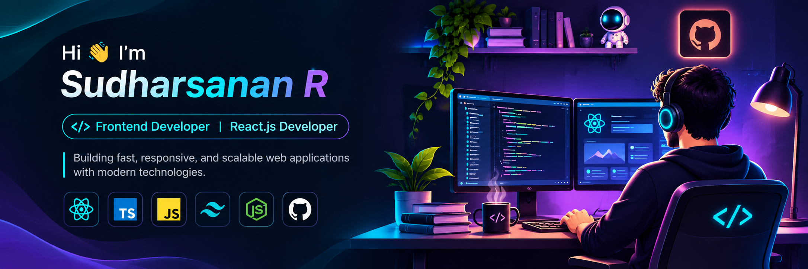

  

 
 

Building fast, responsive, and scalable web applications with React.js and modern frontend technologies .

---

<h2 align="center">🌐 Let's Connect</h2>

  <i>Let's build something great together.</i>

  
  &nbsp;
  
  &nbsp;
  
  &nbsp;
  

---

<h2 align="center">🌐 Let's Connect</h2>

  

  
  &nbsp;
  
  &nbsp;
  
  &nbsp;
  

---

  

---

  

---

## 👨‍💻 About Me

- 💻 Frontend Developer specializing in **React.js and modern web technologies**
- 🎓 B.E. Mechanical Engineering Graduate (2025)
- 🧩 Experienced in building responsive and component-based web applications
- 🔗 Comfortable with REST API integration and dynamic data-driven interfaces
- 🌱 Currently learning **TypeScript and Full Stack Development**
- 🚀 Passionate about creating clean, responsive, and user-friendly experiences
- 🎯 Open to **Frontend Developer opportunities**
- 📫 Reach me at: **sudharsananr04@gmail.com**

---

## 🚀 Tech Stack

### 💻 Frontend

  

### ⚙️ Backend

  

### 🗄️ Database

  

### 🛠️ Tools

  

---

<h2 align="center">🚀 Featured Projects</h2>

  A selection of applications I've designed, developed, and deployed.

<table>
<tr>
<td width="50%" valign="top">

<h3>🤝 RS Hunt</h3>
<strong>Business Networking Platform</strong>

A platform connecting entrepreneurs, professionals, and business owners across Pondicherry and India, encouraging meaningful business connections and collaboration.

<strong>Built With</strong>

<code>React.js</code> <code>Tailwind CSS</code>

  

<a href="https://github.com/sudhar04/RS-Hunt">📂 Source Code</a>
&nbsp; | &nbsp;
<a href="https://rs-hunt.vercel.app/">🌐 Live Demo</a>

</td>
<td width="50%" valign="top">

<h3>🚩 Feature Flag Management</h3>
<strong>Multi-Tenant SaaS Platform</strong>

A feature management platform for dynamically controlling application features, with authentication, backend services, and database-driven configuration.

<strong>Built With</strong>

<code>React.js</code> <code>Node.js</code> <code>Express.js</code> <code>MongoDB</code>

  

<a href="https://github.com/sudhar04/Feature-Flag-Management-System">📂 Source Code</a>
&nbsp; | &nbsp;
<a href="https://multi-feature-flag-management-system.vercel.app/">🌐 Live Demo</a>

</td>
</tr>

<tr>
<td width="50%" valign="top">

<h3>🚌 Bus Ticket Booking</h3>
<strong>Online Bus Reservation Application</strong>

An interactive bus booking application featuring seat selection, a streamlined booking flow, and QR-based ticket generation.

<strong>Built With</strong>

<code>React.js</code> <code>JavaScript</code> <code>Tailwind CSS</code>

  

<a href="https://github.com/sudhar04/Bus-Ticket-Booking-App">📂 Source Code</a>
&nbsp; | &nbsp;
<a href="https://rs-bus-ticket-booking.netlify.app/">🌐 Live Demo</a>

</td>
<td width="50%" valign="top">

<h3>✈️ Flight Search App</h3>
<strong>Flight Discovery Application</strong>

A responsive flight search interface with REST API integration for retrieving and displaying dynamic flight information.

<strong>Built With</strong>

<code>React.js</code> <code>Bootstrap</code> <code>REST API</code>

  

<a href="https://github.com/sudhar04/Flight-Search-App">📂 Source Code</a>
&nbsp; | &nbsp;
<a href="https://rs-flight-search.netlify.app/">🌐 Live Demo</a>

</td>
</tr>

<tr>
<td width="50%" valign="top">

<h3>🏥 Healthcare Dashboard</h3>
<strong>Healthcare Data Visualization</strong>

A responsive dashboard displaying patient information, diagnostic data, vital signs, and blood pressure history through interactive visualizations.

<strong>Built With</strong>

<code>React.js</code> <code>JavaScript</code> <code>Chart.js</code> <code>REST API</code>

  

<a href="https://github.com/sudhar04/Healthcare-Dashboard">📂 Source Code</a>

</td>
<td width="50%" valign="top">

<h3>💼 Job Portal</h3>
<strong>Job Application Tracking System</strong>

A frontend-only job portal featuring job discovery, application forms, skills selection, and application status tracking with centralized state management.

<strong>Built With</strong>

<code>React.js</code> <code>TypeScript</code> <code>Zustand</code> <code>Fluent UI</code>

  

<a href="https://github.com/sudhar04/OneData-Frontend-Assessment">📂 Source Code</a>
&nbsp; | &nbsp;
<a href="https://onedata-frontend-assessment.vercel.app/">🌐 Live Demo</a>

</td>
</tr>

<tr>
<td width="50%" valign="top">

<h3>🚤 Boating Website</h3>
<strong>Responsive Boating Experience</strong>

A modern boating website featuring an engaging interface, responsive layouts, and a consistent experience across desktop, tablet, and mobile devices.

<strong>Built With</strong>

<code>React.js</code> <code>Tailwind CSS</code> <code>JavaScript</code>

  

<a href="https://github.com/sudhar04/Boating-website">📂 Source Code</a>
&nbsp; | &nbsp;
<a href="https://boating-website.vercel.app/">🌐 Live Demo</a>

</td>
<td width="50%" valign="top">

<h3>🎬 CineFlix</h3>
<strong>Movie Discovery Application</strong>

A movie discovery application for exploring trending movies and searching titles using the TMDB API.

<strong>Built With</strong>

<code>React.js</code> <code>TMDB API</code>

  

<a href="https://github.com/sudhar04/cine-flix">📂 Source Code</a>

</td>
</tr>
</table>

  <strong>More projects and experiments coming soon...</strong>

---

## 📈 GitHub Activity

  

---

## 📊 GitHub Statistics

  
  

---

## 🔥 GitHub Contributions

  

---

## 💼 Experience

### Junior Frontend Developer

- Built and maintained responsive web applications using **React.js, JavaScript, HTML, and CSS**.
- Developed reusable UI components and responsive interfaces across different screen sizes.
- Integrated REST APIs to display dynamic application data.
- Worked on web projects across **education, finance, and hospitality domains**.
- Improved UI responsiveness, performance, and cross-browser compatibility.

---

## 🤝 Let's Connect

  <strong>I'm open to opportunities involving Frontend Development,
  React.js, and Full-Stack Web Development.</strong>

  

  

  

  

  <strong>Thanks for visiting my profile! ⭐</strong>

