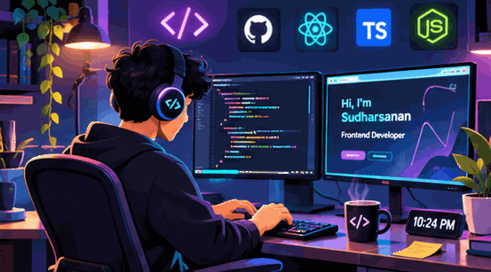
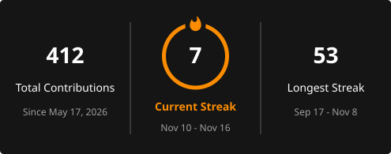

  

 
 

Building fast, responsive, and scalable web applications with React.js and modern frontend technologies .

---

  
 
  

  

  

---

---

<h2 align="center">🌐 Let's Connect</h2>

  Find me across the web · Let's build something meaningful.

  <a href="https://github.com/sudhar04">
    
    <strong> GitHub</strong>
  </a>
  &nbsp;&nbsp; • &nbsp;&nbsp;
  <a href="https://www.linkedin.com/in/sudharsanan-r-developer/">
    
    <strong> LinkedIn</strong>
  </a>
  &nbsp;&nbsp; • &nbsp;&nbsp;
  <a href="https://sudharsanan-portfolio.web.app">
    
    <strong> Portfolio</strong>
  </a>
  &nbsp;&nbsp; • &nbsp;&nbsp;
  <a href="mailto:sudharsananr04@gmail.com">
    
    <strong> Email</strong>
  </a>

  Open to collaboration · Freelance projects · Frontend opportunities

---

  

---

  

---

## 👨‍💻 About Me

- 💻 Frontend Developer specializing in **React.js and modern web technologies**
- 🎓 B.E. Mechanical Engineering Graduate (2025)
- 🧩 Experienced in building responsive and component-based web applications
- 🔗 Comfortable with REST API integration and dynamic data-driven interfaces
- 🌱 Currently learning **TypeScript and Full Stack Development**
- 🚀 Passionate about creating clean, responsive, and user-friendly experiences
- 🎯 Open to **Frontend Developer opportunities**
- 📫 Reach me at: **sudharsananr04@gmail.com**

---

## 🚀 Tech Stack

### 💻 Frontend

  

### ⚙️ Backend

  

### 🗄️ Database

  

### 🛠️ Tools

  

---

## 📌 Featured Projects

### 🤝 RS Hunt — Business Networking Platform

> A premium business networking platform built to connect entrepreneurs, professionals, and business owners across Pondicherry/Puducherry and India, with a focus on meaningful connections, collaboration, and business growth.

**Tech Stack**

`React.js` `Tailwind CSS` `Responsive Design`

📂 **[View Source Code](https://github.com/sudhar04/RS-Hunt)**

🌐 **[Live Demo](https://rs-hunt.vercel.app/)**

---

### 🚩 Feature Flag Management System

> Multi-tenant feature flag management platform for dynamically controlling application features. Built with separate frontend applications, backend services, authentication, and database-driven feature management.

**Tech Stack**

`React.js` `Node.js` `Express.js` `MongoDB` `Postman` `Tailwind CSS`

📂 **[View Source Code](https://github.com/sudhar04/Feature-Flag-Management-System)**

🌐 **[Live Demo](https://multi-feature-flag-management-system.vercel.app/)**

---

### 🚌 Bus Ticket Booking

> Interactive bus booking application with seat selection, booking flow, and QR ticket generation.

**Tech Stack**

`React.js` `Tailwind CSS` `JavaScript` `Responsive Design`

📂 **[View Source Code](https://github.com/sudhar04/Bus-Ticket-Booking-App)**

🌐 **[Live Demo](https://rs-bus-ticket-booking.netlify.app/)** 

---

### ✈️ Flight Search App

> Flight search application with a responsive interface and REST API integration for dynamic flight data.

**Tech Stack**

`React.js` `Bootstrap` `REST API`

📂 **[View Source Code](https://github.com/sudhar04/Flight-Search-App)**

🌐 **[Live Demo](https://rs-flight-search.netlify.app/)**

---

### 🏥 Healthcare Dashboard

> Responsive healthcare dashboard displaying patient information, diagnostic data, vital signs, and blood pressure history through interactive data visualizations.

**Tech Stack**

`React.js` `JavaScript` `CSS3` `Chart.js` `REST API`

📂 **[View Source Code](https://github.com/sudhar04/Healthcare-Dashboard)**

---

### 💼 Job Portal – Job Application Tracking System

> A responsive Job Portal application that enables users to search and explore job opportunities, submit applications, and track their application status through an interactive dashboard.

**Tech Stack**

`React.js` `TypeScript` `Zustand` `Responsive Design` `Fluent UI`

📂 **[View Source Code](https://github.com/sudhar04/OneData-Frontend-Assessment)**

🌐 **[Live Demo](https://onedata-frontend-assessment.vercel.app/)**

---

### 🚤 Boating Website

> Modern and responsive boating website featuring an engaging user interface and responsive layouts across desktop, tablet, and mobile devices.

**Tech Stack**

`React.js` `Tailwind CSS` `JavaScript` `Responsive Design`

📂 **[View Source Code](https://github.com/sudhar04/Boating-website)**

🌐 **[Live Demo](https://boating-website.vercel.app/)**

---

## 📈 GitHub Activity

  

---

## 📊 GitHub Statistics

  
  

---

## 🔥 GitHub Contributions

  

---

## 💼 Experience

### Junior Frontend Developer

- Built and maintained responsive web applications using **React.js, JavaScript, HTML, and CSS**.
- Developed reusable UI components and responsive interfaces across different screen sizes.
- Integrated REST APIs to display dynamic application data.
- Worked on web projects across **education, finance, and hospitality domains**.
- Improved UI responsiveness, performance, and cross-browser compatibility.

---

## 🤝 Let's Connect

  <strong>I'm open to opportunities involving Frontend Development,
  React.js, and Full-Stack Web Development.</strong>

  

  

  

  

  <strong>Thanks for visiting my profile! ⭐</strong>

